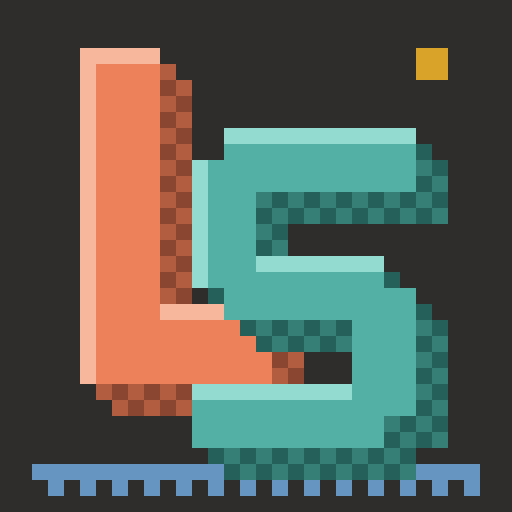

# Leikstöð

Turns a video into a PlayStation 1–style scene: everything becomes a chunky, low-poly 3D model with wobbly vertices, warped textures, fog and dithered 15-bit color.

**▶ Run it in your browser: [sungammagnus.github.io/leikstod](https://sungammagnus.github.io/leikstod/)**

Nothing is uploaded. The video, the depth model and the rendering all run locally in your browser.

## How it works

1. Each frame goes through [Depth Anything V2](https://huggingface.co/onnx-community/depth-anything-v2-small), which estimates how far away every pixel is.
2. That depth pushes a coarse triangle grid in and out, turning the frame into a 3D surface.
3. In **Layered fill** mode, the subject is cut free at depth edges and given rounded sides. A background layer is rebuilt behind it, from background seen in earlier frames or guessed from the surroundings.
4. The scene is rendered with PS1 quirks: vertices snapped to the pixel grid, affine (non-perspective) texture mapping, flat per-triangle color and shading, fog, and ordered dithering at a low resolution.

## Using it

- **Open video**, or drop a file onto the view. **Webcam** works for live preview.
- Drag the view to orbit the camera; double-click to reset it.
- Value boxes: drag up or down to change (Shift for fine), double-click or press Enter to type, arrow keys to step.
- Timeline: **Play** (Space) and a playback speed menu sit on the left. Speed only affects the preview; exports keep the original timing.
- **In** / **Out** (or the I and O keys) mark the range to export, and the range edges can be dragged to adjust it. **Clear** (X) removes it. Playback loops inside the range.
- **Export MP4** renders every frame of the range. Output quality: Low = 2× render size, Medium = 4× (up to 4K), High = 1080p.

## Requirements

- A recent Chrome or Edge on desktop. WebGPU makes depth estimation fast; without it the app falls back to a much slower CPU path. MP4 export needs WebCodecs.
- The first load downloads the depth model (about 100 MB); after that it's cached.
- No audio in exports yet.

## Running locally

It's a single `index.html` with no build step. Serve the folder over HTTP (the model cache needs a secure context, which `localhost` counts as):

```bash
python3 -m http.server 8000
```

Then open http://localhost:8000.

## Built with

[three.js](https://threejs.org), [Transformers.js](https://github.com/huggingface/transformers.js), [Depth Anything V2](https://github.com/DepthAnything/Depth-Anything-V2) and [mp4-muxer](https://github.com/Vanilagy/mp4-muxer). Interface in the Sungam graphite style.
